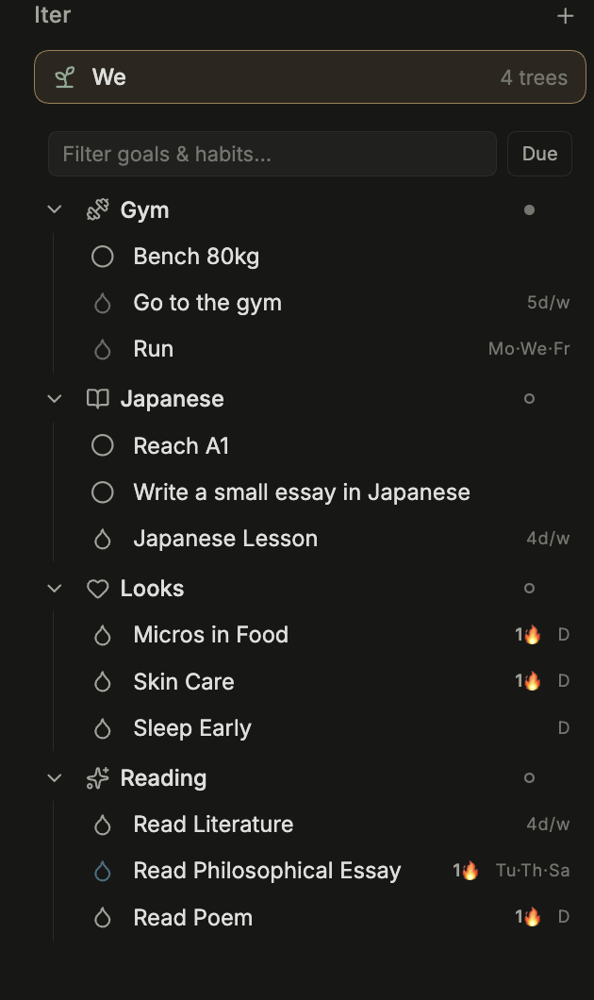
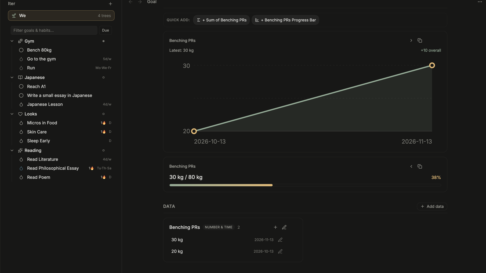
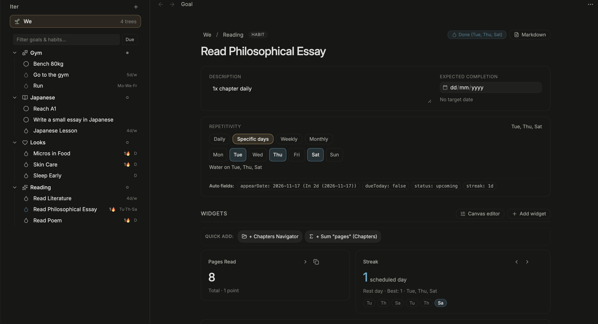

# Iter for Obsidian

**Grow a garden of goals inside your Obsidian vault.** Give each long-term goal a tree, break it into milestones, and water it by completing the habits that support it. Build dashboards from the notes and numbers you already keep in Obsidian.

[Documentation](https://mateusdcc.github.io/obsidian-iter/) · [Download](https://github.com/mateusdcc/obsidian-iter/releases/latest) · [Contribute](CONTRIBUTING.md)

[](https://github.com/mateusdcc/obsidian-iter/actions/workflows/ci.yml) [](LICENSE)


## What you can do

- Set up a tree for Reading, Japanese, or Gym. Give it a target date or keep it ongoing.
- Water recurring habits on daily, selected-day, weekly, or monthly schedules. The We Garden shows today's queue and how each tree is growing.
- Build dashboards with streaks, progress bars, charts, and linked notes. Pull numeric properties such as pages or exam scores from Obsidian notes and combine datasets across a tree.
- Put a live widget or today's habit tracker inside a Markdown note. Use the visual Canvas widget editor to filter, combine, or summarize data for a custom widget.

## Install with BRAT

Requires Obsidian **1.14.5 or later**. Install Iter in each vault where you want to use it.

1. Open **Settings → Community plugins → Browse**. Turn on community plugins if prompted, then install and enable **BRAT** (Beta Reviewer's Auto-update Tool).
2. Open the command palette and run **BRAT: Add a beta plugin for testing**, or choose **Add beta plugin** in BRAT settings.
3. Paste `https://github.com/mateusdcc/obsidian-iter`. Choose **Latest version** if prompted, then select **Add Plugin**.
4. In **Settings → Community plugins**, enable **Iter** if BRAT left it disabled.

BRAT can check for updates from the repository. To pin a version, use BRAT's option to select a release tag during setup.

<details>
<summary>Install manually</summary>

1. Download `main.js`, `manifest.json`, and `styles.css` from the same [GitHub release](https://github.com/mateusdcc/obsidian-iter/releases/latest).
2. Put all three files in `.obsidian/plugins/iter/` inside your vault.
3. Reload Obsidian and enable **Iter** under **Settings → Community plugins**.

</details>

## Start a garden

1. In the command palette, run **Iter: Create tree** and name it **Reading**.
2. Run **Iter: Create habit**, select **Reading**, and create a daily **Read 10 pages** habit. Add **Finish a book** with **Iter: Create subgoal**.
3. Run **Iter: Open We garden**. Select **Water** when you complete the habit, and open the tree to review its progress.
4. Open a goal or habit and use **Add data** and **Add widget** to build a dashboard. Follow the [worked examples](https://mateusdcc.github.io/obsidian-iter/#examples) for linked note properties and time graphs.

Iter creates an `Iter/` folder in your vault. Goals, schedules, watering history, datasets, and widget configuration live in Markdown and YAML frontmatter. Back up or sync the folder with the rest of your vault, including any source notes your datasets link to.

## Screenshots

### Iter panel

Browse your trees, subgoals, and scheduled habits in the Obsidian sidebar.



### Bench 80 kg

Use a dated workout log to chart your lifts and track progress toward a target weight.



### Reading habit

Schedule a habit for specific days and see its streak alongside a pages-read total.



## Development

Use Node.js 24 and npm.

```sh
npm ci
npm test
npm run build
```

See [CONTRIBUTING.md](CONTRIBUTING.md) for a test vault setup, release steps, and how to edit the docs. Report bugs or share ideas via [GitHub Issues](https://github.com/mateusdcc/obsidian-iter/issues/new/choose). See [SECURITY.md](SECURITY.md) for private security reports.

Iter is released under the [MIT License](LICENSE).
